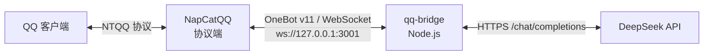

# qq-bridge

把 **QQ 群 / 私聊** 接到 **DeepSeek** 的轻量机器人：基于 OneBot v11 正向 WebSocket，零第三方依赖，一个文件就能跑。

- 群里 **@机器人** 或发 **`/ai 问题`** 即可对话，也支持 **引用机器人的消息** 继续追问
- 可选 **语音**：发语音提问自动转文字，回答也能念出来（`/voice` 切换语音回复）
- 可选 **画图**：`/draw 一只戴墨镜的橘猫` 直接出图
- 每个用户（或整群）独立的多轮上下文，可随时 `重置`
- 群白名单、用户黑名单、冷却时间、长度限制，避免被刷
- 长回复自动分条，超时/限流自动重试
- 自带端到端测试：mock 协议端 + mock 模型，不连真 QQ、不花 API 额度

> 当前只支持 **正向 WebSocket**（本程序作为客户端连 NapCat 的 WS 服务器）。反向 WS 需要改代码。

## 工作原理



1. NapCatQQ 登录你的 QQ 号，对外暴露 OneBot v11 的 WebSocket 服务。
2. `qq-bridge` 连上去，收消息事件、调 `send_group_msg` / `send_private_msg` 发消息。
3. 触发条件满足时，把文本（含上下文）发给 DeepSeek，把回复发回群里。

## 快速开始

### 0. 准备

| 依赖 | 版本 | 说明 |
| --- | --- | --- |
| [Node.js](https://nodejs.org/) | **>= 22** | 用到内置 `WebSocket` 和 `fetch`，20 及以下不行 |
| [NapCatQQ](https://github.com/NapNeko/NapCatQQ) | 最新版 | QQ 协议端，需自行准备一个可登录的 QQ 号 |
| DeepSeek API Key | — | 在 [platform.deepseek.com/api_keys](https://platform.deepseek.com/api_keys) 创建，`sk-` 开头 |
| 硅基流动 API Key | 可选 | 只有想用**语音 / 画图**才需要，到 [cloud.siliconflow.cn](https://cloud.siliconflow.cn) 注册后创建 |

### 1. 启动 NapCatQQ 并开启 WebSocket 服务器

1. 按 NapCat 文档安装并启动，用 QQ 扫码登录。
2. 打开 NapCat 的 WebUI（默认 `http://127.0.0.1:6099`），进入 **网络配置**。
3. 新建 **WebSocket 服务器**：
   - 主机：`127.0.0.1`（只给本机用，更安全）
   - 端口：`3001`
   - Token：可留空，也可填一串随机字符串（填了就要同步到 `config.json`）
4. 保存并启用，确认状态为“运行中”。

> 不同 NapCat 版本的菜单名称略有差异，认准 **WebSocket 服务器 / WebSocket Server** 即可。

### 2. 配置 qq-bridge

```bash
cp config.example.json config.json
```

编辑 `config.json`，至少改这两处：

```jsonc
{
  "onebot": { "url": "ws://127.0.0.1:3001", "accessToken": "" },
  "deepseek": { "apiKey": "sk-你的Key", "model": "deepseek-chat" }
}
```

如果 NapCat 里设了 Token，把同样的值填到 `onebot.accessToken`。

### 3. 启动

```bash
npm start
# 等价于 node bot.mjs
```

看到这样的日志就成功了：

```
[info] 配置：config.json
[info] qq-bridge v1.0.0 启动，模型=deepseek-chat
[info] 已连接到 OneBot 协议端 ws://127.0.0.1:3001
[info] 登录账号：你的昵称（123456789）
```

然后在群里 **@机器人 你好** 试试。

Windows 下也可以直接双击 `start-bot.cmd`（会优先找 PATH 里的 node）。

## 触发方式

| 方式 | 示例 | 说明 |
| --- | --- | --- |
| @机器人 | `@机器人 今天天气怎么样` | 最常用；`trigger.at` 关闭后失效 |
| 文字前缀 | `/ai 今天天气怎么样` | 前缀可配置，默认 `/ai`、`ai:`、`AI:` |
| 引用回复 | 引用机器人的消息 → 直接打字 | `trigger.replyToBot` 控制是否启用 |
| 画图指令 | `/draw 一只戴墨镜的橘猫` | 需要 `image.enabled`，前缀可配 |

- 只 @ 不写字（或只发前缀）会回复帮助信息。
- `trigger.requireAtInGroup: true` 时，**群里只认 @**，前缀会被忽略；私聊不受影响。
- 没触发条件的普通群聊消息不会消耗任何额度。

## 内置指令

指令本身也需要先触发（@机器人 或 加前缀），不区分大小写：

| 指令 | 作用 |
| --- | --- |
| `重置` / `清空` / `reset` / `清除上下文` | 清空当前会话上下文 |
| `状态` / `status` | 查看模型、上下文轮数、处理条数、在线时长 |
| `帮助` / `help` / `?` / `？` | 显示用法 |
| `/voice` | 切换本会话是否用语音回复 |

指令不受冷却时间限制。

## 语音与画图（可选）

两者都走**硅基流动**的 OpenAI 兼容接口，一个 Key 就够；不用就保持 `enabled: false`，不影响文字对话。

### 开通

1. 到 [cloud.siliconflow.cn](https://cloud.siliconflow.cn) 注册，进入 **API 密钥** 创建一个（`sk-` 开头）。
2. 填进 `config.json`：

```jsonc
{
  "speech": {
    "enabled": true,
    "apiKey": "sk-硅基流动的Key",
    "ttsModel": "FunAudioLLM/CosyVoice2-0.5B",
    "voice": "FunAudioLLM/CosyVoice2-0.5B:anna",
    "asrModel": "FunAudioLLM/SenseVoiceSmall"
  },
  "image": {
    "enabled": true,
    "apiKey": "",            // 留空 = 复用 speech.apiKey
    "model": "Kwai-Kolors/Kolors"
  }
}
```

3. 重启机器人，日志里出现 `语音：开` / `画图：开` 即生效。

> 模型名/音色以硅基流动控制台为准。音色写在模型名后面，例如 `:anna`、`:bella`、`:claire`、`:david`、`:alex`。

### 怎么用

| 场景 | 操作 |
| --- | --- |
| 语音提问 | 直接在群里发语音（需先 @机器人 或加前缀）→ 自动转文字 → 回答 |
| 语音回复 | 收到语音提问时默认用语音回；也可发 `/voice` 让之后都用语音 |
| 画图 | `/draw 一只戴墨镜的橘猫`（前缀还有 `/画`、`画图`） |

细节：

- 回答超过 `speech.maxChars`（默认 300 字）就不念了，直接发文字——长文念出来体验很差。
- TTS 失败会自动回落成文字，不会把消息吞掉。
- 画图会先回一句“正在画，稍等…”，出图后单独发图片。
- 图片/语音通过 `media.transport` 交给协议端：
  - `file`（默认）：写到本地 `tmp/`，用 `file:///` 路径发，**要求机器人和 NapCat 在同一台机器**，大图不占带宽；
  - `base64`：内联进消息段，跨机器也能用，但图片越大 WebSocket 帧越大。
  - 两个选项都会在失败时自动换另一种。

## 配置说明

> 所有字段都可省略，缺省值见下表。**环境变量优先于配置文件**。

### onebot —— 协议端连接

| 字段 | 默认 | 说明 |
| --- | --- | --- |
| `url` | `ws://127.0.0.1:3001` | NapCat WebSocket 服务器地址 |
| `accessToken` | `""` | 与 NapCat 里配置的 Token 一致；非空时以 `?access_token=` 传入 |
| `reconnectMinMs` | `3000` | 断线重连最小间隔 |
| `reconnectMaxMs` | `60000` | 重连退避上限 |
| `apiTimeoutMs` | `15000` | 单次 OneBot API 调用超时 |

### deepseek —— 模型

| 字段 | 默认 | 说明 |
| --- | --- | --- |
| `baseUrl` | `https://api.deepseek.com` | 兼容 OpenAI 协议的地址，可换成中转 |
| `apiKey` | — | 必填，`sk-` 开头 |
| `model` | `deepseek-chat` | 也可用 `deepseek-reasoner` |
| `temperature` | `0.7` | 随机度 |
| `maxTokens` | `800` | 单次回复上限 |
| `timeoutMs` | `60000` | 请求超时 |
| `maxRetries` | `2` | 超时 / 429 / 5xx 的重试次数，指数退避 |
| `systemPrompt` | 见示例 | 人设与风格约束 |

### trigger —— 触发

| 字段 | 默认 | 说明 |
| --- | --- | --- |
| `at` | `true` | 允许 @机器人 触发 |
| `replyToBot` | `true` | 允许引用机器人消息触发 |
| `prefixes` | `["/ai","ai:","AI:"]` | 文字前缀列表，匹配后会被剥掉 |
| `requireAtInGroup` | `false` | `true` = 群里只认 @ |

### reply —— 发送

| 字段 | 默认 | 说明 |
| --- | --- | --- |
| `quote` | `false` | 是否以“引用回复”形式发出 |
| `atUser` | `true` | 回复时 @提问者 |
| `maxChars` | `1200` | 单条长度上限，超出按行/句切分 |
| `maxParts` | `3` | 最多分几条 |

### policy —— 权限与上下文

| 字段 | 默认 | 说明 |
| --- | --- | --- |
| `allowedGroups` | `[]` | 群白名单；为空表示所有群都响应 |
| `blockedUsers` | `[]` | 黑名单 QQ 号 |
| `contextScope` | `"user"` | `user` = 群内每人独立上下文；`group` = 整群共享 |
| `maxContextTurns` | `6` | 保留最近几轮问答 |
| `contextTtlMinutes` | `60` | 上下文闲置多久后丢弃 |
| `cooldownSeconds` | `2` | 同一用户两次提问的最小间隔 |
| `maxInputChars` | `2000` | 单次提问长度上限 |
| `allowPrivate` | `false` | 是否响应私聊 |

### media —— 媒体传输

| 字段 | 默认 | 说明 |
| --- | --- | --- |
| `tempDir` | `tmp` | 临时文件目录（相对程序目录，自动清理 1 小时前的残留） |
| `transport` | `"file"` | `file` = 本地路径发送；`base64` = 内联进消息段 |
| `maxBytes` | `8388608` | 单个媒体上限，超出直接放弃发送 |

### speech —— 语音

| 字段 | 默认 | 说明 |
| --- | --- | --- |
| `enabled` | `false` | 开关；没配 Key 时会自动关闭并告警 |
| `baseUrl` | `https://api.siliconflow.cn/v1` | OpenAI 兼容地址 |
| `apiKey` | `""` | 语音合成与识别共用 |
| `ttsModel` | `FunAudioLLM/CosyVoice2-0.5B` | 语音合成模型 |
| `voice` | `FunAudioLLM/CosyVoice2-0.5B:anna` | 音色 |
| `speed` | `1.0` | 语速 |
| `maxChars` | `300` | 超过这个长度改发文字 |
| `replyMode` | `"on-voice-input"` | `always` = 总是语音回复 |
| `asrModel` | `FunAudioLLM/SenseVoiceSmall` | 语音识别模型 |

### image —— 画图

| 字段 | 默认 | 说明 |
| --- | --- | --- |
| `enabled` | `false` | 开关；没配 Key 时自动关闭 |
| `baseUrl` | `https://api.siliconflow.cn/v1` | 生图接口地址 |
| `apiKey` | `""` | 留空复用 `speech.apiKey` |
| `model` | `Kwai-Kolors/Kolors` | 也可用 `black-forest-labs/FLUX.1-schnell` |
| `size` | `1024x1024` | 图片尺寸 |
| `steps` | `20` | 采样步数 |
| `guidance` | `7.5` | 提示词引导强度 |
| `negativePrompt` | `""` | 反向提示词 |
| `prefixes` | `["/draw","/画","画图"]` | 触发前缀 |
| `timeoutMs` | `120000` | 生图超时，比对话慢很多 |

### log —— 日志

| 字段 | 默认 | 说明 |
| --- | --- | --- |
| `level` | `"info"` | `debug` / `info` / `warn` / `error` |
| `file` | `logs/bot.log` | 相对程序目录 |
| `rotateBytes` | `5242880` | 超过后轮转为 `.log.1` |

### 环境变量

适合用 Docker / systemd 部署时注入，避免 Key 落盘：

| 变量 | 覆盖 |
| --- | --- |
| `DEEPSEEK_API_KEY` | `deepseek.apiKey` |
| `DEEPSEEK_BASE_URL` | `deepseek.baseUrl` |
| `DEEPSEEK_MODEL` | `deepseek.model` |
| `ONEBOT_WS_URL` | `onebot.url` |
| `ONEBOT_ACCESS_TOKEN` | `onebot.accessToken` |
| `SILICONFLOW_API_KEY` | `speech.apiKey` 和 `image.apiKey` |
| `SPEECH_API_KEY` | 只覆盖 `speech.apiKey` |
| `IMAGE_API_KEY` | 只覆盖 `image.apiKey` |

也可以 `node bot.mjs --config /path/to/other.json` 指定别的配置文件。

## 测试

不需要真实 QQ 号和 API Key：

```bash
npm test
```

会启动 mock OneBot 协议端（端口 18080）、mock DeepSeek（18081）和 mock 语音/生图服务（18083），覆盖 @触发、前缀触发、上下文累积、重置、状态、长文分条、群白名单、Token 鉴权、画图、语音转写、语音回复、`/voice` 切换等 24 个断言。

画图与语音用例走的是 mock 服务，同样不需要真实 Key、不产生任何费用。

## 目录结构

```
qq-bridge/
├── bot.mjs                 # 全部逻辑：配置、OneBot 客户端、DeepSeek、语音、画图
├── config.example.json     # 配置模板
├── start-bot.cmd           # Windows 一键启动
├── package.json
├── test/
│   ├── e2e.mjs             # 端到端测试
│   ├── mock-onebot.mjs     # 假协议端（WS 服务器）
│   ├── mock-deepseek.mjs   # 假模型（HTTP 服务器）
│   └── mock-media.mjs      # 假语音/生图服务
└── .github/workflows/ci.yml
```

## 常见问题

**连不上协议端 / 一直重连**
确认 NapCat 里建的是 **WebSocket 服务器**（不是客户端），端口与 `onebot.url` 一致；若设置了 Token，`accessToken` 必须相同。先用 `ws://127.0.0.1:3001` 在本机验证。

**启动直接退出，提示没有 API Key**
Key 没填或还是模板里的占位文字。写进 `config.json` 或设置 `DEEPSEEK_API_KEY`。

**回复“API Key 无效” / “额度不足”**
分别对应 401/403 和 402：检查 Key 是否失效、账户是否欠费。

**@了但没反应**
检查：群号是否在 `allowedGroups`（非空时只响应白名单群）、用户是否在 `blockedUsers`、是否开了 `requireAtInGroup` 却用了前缀、是否在同一用户 2 秒冷却内。

**图片 / 语音 / 文件能识别吗？**
不能。非文字消息会变成 `[图片]`、`[语音]` 之类的占位符交给模型，模型看不到实际内容。

**回复被拆成好几条**
`reply.maxChars`（默认 1200）限制单条长度，超出会按换行/句号切分，最多 `maxParts` 条。

**上下文串了 / 想整群共享**
默认每人独立。改 `policy.contextScope` 为 `"group"` 则整群共享一份上下文。

**发语音没反应 / 提示“没能取到这条语音”**
机器人要先拿到音频文件：优先用消息段里的 `url`，没有就调 OneBot 的 `get_record` 去 NapCat 机器上读文件。如果 NapCat 和机器人不在同一台机器，通常取不到——把 `media.transport` 改成 `base64` 也不解决取文件的问题，需要让 NapCat 暴露可访问的 `url`。

**语音回复没声音，只来了文字**
看日志里的 `TTS 失败`：多半是 Key 没开语音权限、音色名写错，或回答超过 `speech.maxChars`（超长会故意改发文字）。

**画图很慢或报“生图失败”**
生图通常 10–60 秒，`image.timeoutMs` 别设太小；免费额度/并发限制也会导致 429，日志里能看到 HTTP 状态码。

**图片发不出去**
先看是不是超过 `media.maxBytes`。`transport: "file"` 要求机器人和 NapCat 同机且路径可读；不行就换 `"base64"`（脚本会自动兜底尝试一次）。

## 安全提示

- **`config.json` 已在 `.gitignore` 里，不要提交**，更不要把 Key 贴到 Issue 或截图里。
- Key 一旦泄露，立刻去 DeepSeek 控制台作废并重建。
- 公网部署时把 NapCat 的 WebSocket 监听在 `127.0.0.1` 并设置 Token，不要裸奔在 `0.0.0.0`。
- 建议用 `allowedGroups` 限定只在自家群生效，避免陌生人白嫖额度。

## License

[MIT](LICENSE)
